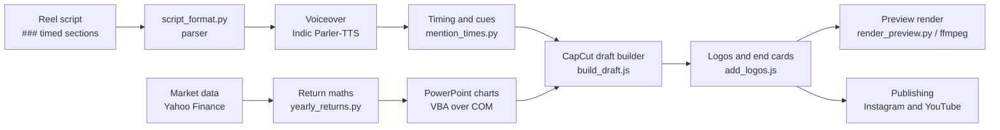

# social-media-video-claude

[](https://github.com/raj-vora/social-media-video-claude/actions/workflows/ci.yml)

A toolchain that turns structured research into short vertical videos. It takes numbers
from market data, writes them into a timed script, narrates the script with neural TTS,
draws animated charts, and assembles editable CapCut projects timed to the voiceover,
with logos, on-screen text, and end cards. An ffmpeg renderer previews each project
without CapCut.

The repository contains the tooling only. The scripts, footage, data tables, and renders
for each series are not included, so the pipeline needs your own content (see
[Running it](#running-it)). The tools are for education. Nothing here is investment advice.

## Pipeline



## Engineering notes

- **Pure logic is separated from side effects.** The script parser
  (`invit-analysis-2026/voiceover/script_format.py`) has no TTS dependency, so it is
  tested on its own and reused by the timing and voiceover tools. The return maths
  (`invit-analysis-2026/data/yearly_returns.py`) takes parsed API payloads, so it is tested
  without network access.
- **Expensive work is cached and crash-safe.** Each synthesised sentence is cached under a
  hash of its text and delivery style, so a crash or a restart loses only the sentence in progress. Changing
  the playback tempo re-runs offline, from cache.
- **Output that a human edits is protected.** The draft builders back up a project before
  rewriting it, keep CapCut's draft IDs stable, and skip projects that were edited by hand
  unless forced.
- **Platform identifiers are not stored.** The draft builder generates its device
  fingerprint per machine instead of writing one into the repository.
- **Configuration comes from the environment.** No paths are hard-coded; see the table below.
- **Secrets stay out of the repository.** Credentials are read from a git-ignored
  `.secrets/` folder at run time.

## Repository layout

| Path | Contents |
|---|---|
| `invit-analysis-2026/` | Explainers on InvITs: return data, charts, voiceover, CapCut drafts, publishing helpers |
| `dividend-income-2026/` | Short and long-form dividend-stock videos: data scripts, footage fetching, overlays, thumbnails |
| `exdiv-nov-2026/` | Ex-dividend shorts and a long-form video: ex-date data, ASR check, thumbnails |
| `gold-2026/` | Gold and Sovereign Gold Bond price analysis and fetching |
| `tests/` | Unit tests for the parser and the return maths |
| `.github/workflows/ci.yml` | CI: unit tests, byte-compile, JavaScript syntax check |
| `examples/sample_script.md` | One placeholder section showing the script format |

## Quick start

No dependencies are needed to run the tests:

```bash
python -m unittest discover -s tests -v
```

The CI workflow runs the same tests on Python 3.12, byte-compiles every Python file, and
runs `node --check` on every JavaScript file.

## Running it

The full pipeline runs on Windows, because it drives CapCut and PowerPoint.

- **Python 3.12** for the voiceover and image tools. `requirements.txt` lists the packages.
- **Node.js** for the draft builders. They use only the standard library.
- **ffmpeg and ffprobe** on `PATH`.
- **Environment variables.** Set these in your shell or system settings; Node does not read `.env`.

  | Variable | Used by | Example |
  |---|---|---|
  | `CAPCUT_DRAFTS_DIR` | draft builders, `render_preview.py` | `%LOCALAPPDATA%\CapCut\User Data\Projects\com.lveditor.draft` |
  | `CAPCUT_FONT` | `render_preview.py` | path to CapCut's `en.ttf` |
  | `FFPROBE` | probe scripts (optional) | path to `ffprobe` if it is not on `PATH` |
  | `CAPCUT_DEVICE_ID`, `CAPCUT_DISK_ID`, `CAPCUT_MAC_ID` | draft builder (optional) | fixed values for reproducible drafts |
  | `PIXABAY_API_KEY` | `fetch_footage.py` (optional) | your Pixabay key |
  | `VIDS_BASE_URL` | `publish/host_video.py` (optional) | HTTPS base of your own video host |

- **Publishing credentials** (Meta and YouTube OAuth) go in a git-ignored `.secrets/`
  folder. `publish/post_reel.py` describes the files it reads.

The reel-definition file and per-series script modules hold each series' content. They
are not included, so the builders will not run out of the box. Write your own, following
[`examples/sample_script.md`](examples/sample_script.md), to use the pipeline.

## Status and limitations

- The Python parser and return maths are unit-tested. The JavaScript draft builders are
  checked for syntax only, because they write into CapCut's project format and need a
  real CapCut install to verify.
- The CapCut project format is undocumented. The builders were reverse-engineered from
  projects saved by CapCut 9.x, and they may break after an upgrade.
- The voiceover and chart steps depend on local hardware and software (a GPU is optional,
  PowerPoint is required for charts).

## License

MIT. See [`LICENSE`](LICENSE).
